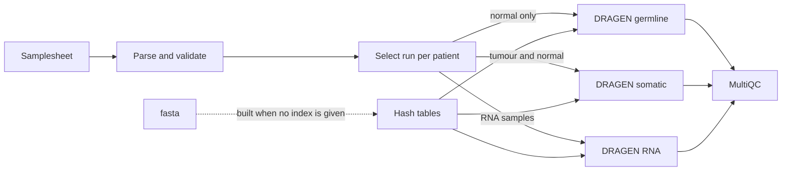
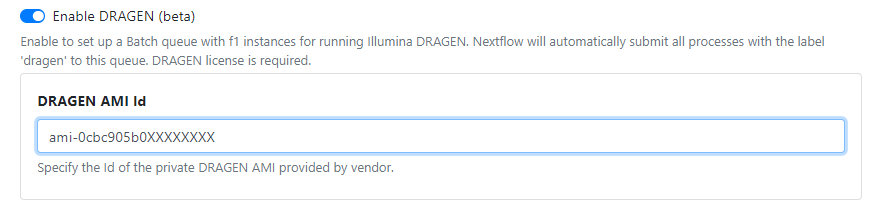

[](https://www.nextflow.io/)

> This is a proof-of-concept pipeline under active development. Syntax, layout and parameters may change without notice.

## Introduction

**seqeralabs/nf-dragen** runs the [Illumina DRAGEN](https://emea.illumina.com/products/by-type/informatics-products/dragen-bio-it-platform.html) licensed suite of tools on FASTQ samples. It produces germline calls for DNA samples, tumour/normal somatic calls, and RNA alignments, and summarises the DRAGEN metrics in a MultiQC report.

The pipeline is built with [Nextflow](https://www.nextflow.io). DRAGEN runs from the AWS Marketplace pay-as-you-go DRAGEN AMI on AWS F2 instances, so a real run needs a compute environment that uses that AMI (see [Requirements](#requirements)).

## Pipeline steps

1. **Samplesheet parsing.** Reads the samplesheet, which uses the same columns as nf-core/sarek, and checks it before any task runs. Several rows with the same sample name are that sample's FASTQ pairs (for example its lanes; the `lane` column is ignored), and each becomes one DRAGEN read group, `<sample>.1`, `<sample>.2`, ... (`<sample>` for a single row). A sample's rows must agree on patient, status, sex and seq_type, and be all paired-end or all single-end.
2. **Run selection.** Groups DNA samples by patient: a normal without a tumour gets a germline run, and a normal with a tumour gets a somatic run (one tumour per patient). RNA samples get an RNA run.
3. **Hash tables.** Builds the DRAGEN DNA and RNA hash tables from `--fasta`, unless you supply them with `--dragen_index_dna` and `--dragen_index_rna`. The `--fasta` must not contain ALT contigs, for example the GRCh38 no-ALT analysis set, because DRAGEN needs a liftover file to build from them and the pipeline does not pass one.
4. **DRAGEN.** Runs germline and somatic DNA calling (somatic runs also call structural variants, and copy number variants for whole-genome data) and RNA alignment.
5. **MultiQC.** Summarises the DRAGEN metrics and the software versions in one report. Skip it with `--skip_multiqc`.



## Quickstart

Run the test profile in stub mode from the repository root. Stub mode does not run DRAGEN, so it needs neither the AMI nor a licence. The test profile and the nf-test tests read their input data from nf-core/test-datasets, so they need network access to raw.githubusercontent.com:

```bash
nextflow run . -profile test -stub -output-dir results
```

A real run needs the DRAGEN AMI on F2 instances (see [Requirements](#requirements)):

```bash
nextflow run . --input samplesheet.csv --fasta genome.fa -output-dir results
```

`-output-dir` (one dash) is required on every run. It is a Nextflow option, not a pipeline parameter; you can set `outputDir` in a config file instead. Without either, Nextflow writes to `results/` in the launch directory.

Read [docs/usage.md](docs/usage.md) for the samplesheet format and run options.

## Requirements

- Nextflow 26.10.6 or later.
- A DRAGEN-capable compute environment: the AWS Marketplace pay-as-you-go DRAGEN AMI on AWS F2 instances, in a region where F2 instances are available. AWS meters the DRAGEN licence, so no credentials are needed. The instances need outbound internet access for DRAGEN's licence check. The DRAGEN processes carry the `dragen` label, which sends them to those instances.
- Docker on the machine that runs MultiQC. The DRAGEN processes run on the host and need no container.

### Bring your own licence

By default DRAGEN runs from the AWS Marketplace AMI and needs no credentials. To use Illumina's private DRAGEN AMI and your own licence instead, run with `-profile byol` (it sets `--dragen_license byol`) and add the Nextflow secrets `DRAGEN_USERNAME` and `DRAGEN_PASSWORD` (in Seqera Platform, as pipeline secrets selected at launch). Every DRAGEN task then passes them to `--lic-server`. Without the secrets the DRAGEN tasks fail with `Required secrets are missing`. BYOL has only been tested in stub mode, not on real DRAGEN.

### Seqera Platform setup

You can use Seqera Batch Forge to create an AWS Batch compute environment with F2 instances. In the Seqera UI, go to `Compute Environments` -> `Add Compute Environment`, fill in your AWS Batch settings and paste the AWS Marketplace pay-as-you-go DRAGEN AMI id:



Also set these in the compute environment:

- Enable Fusion v2, Wave and fast instance storage (NVMe).
- Use on-demand instances, not Spot: a reclaimed instance pays the DRAGEN fee again.
- Leave the compute environment's own Nextflow config empty. Platform appends its own `aws.batch.volumes` after it, so the volumes below must go in the launch config.

Paste this into the **Nextflow config** field of the Launchpad entry or launch form. It applies with or without `-profile byol`, and was tested on DRAGEN 4.4.4 on `f2.6xlarge`:

```groovy
aws.batch.volumes = '/scratch/fusion:/tmp,/opt/edico,/var/lib/edico,/lib64/libdragen.so.4.4.4,/ephemeral'

process {
    withLabel: 'dragen' {
        // Without /ephemeral, DRAGEN fails with an async_io I/O error (exit 134).
        scratch = '/ephemeral'
        containerOptions = '-e FUSION_CACHE_LOCATION=/ephemeral -e FUSION_COMPACT_SYMLINKS=true -e FUSION_STOP_SHUTDOWN_TIMEOUT=2h'
        // Integer.MAX_VALUE adds a retry for the ECS agent restart shortly after an F2 host boots.
        errorStrategy = { task.exitStatus in ((130..145) - 134) + 104 + Integer.MAX_VALUE ? 'retry' : 'finish' }
        maxRetries = 3
    }
}
```

The `libdragen.so` version in `aws.batch.volumes` must match the DRAGEN version of your AMI.

Each launch must also set these:

- Output directory: the **Output directory** field under General config in the launch form, or `tw launch --output-dir s3://bucket/results/run1`. Platform passes it to Nextflow as `-output-dir`. You can also put `outputDir = 's3://bucket/results/run1'` in the launch config. The field is not carried over when you relaunch a run, so set it again.
- Syntax parser v2: in the launch form, or with `tw launch --syntax-parser v2`.
- Nextflow 26.10.6: add `export NXF_VER=26.10.6` to the pre-run script.

## Documentation

- [Usage](docs/usage.md): samplesheet format, run modes, configuration and running the pipeline.
- [Output](docs/output.md): the files the pipeline writes to the output directory.
- [Parameters](docs/parameters.md): every pipeline parameter.

## Credits

nf-dragen was originally written by [Harshil Patel](https://github.com/drpatelh), [Graham Wright](https://github.com/gwright99) and [Paolo Di Tommaso](https://github.com/pditommaso), [Seqera Labs](https://seqera.io/).
