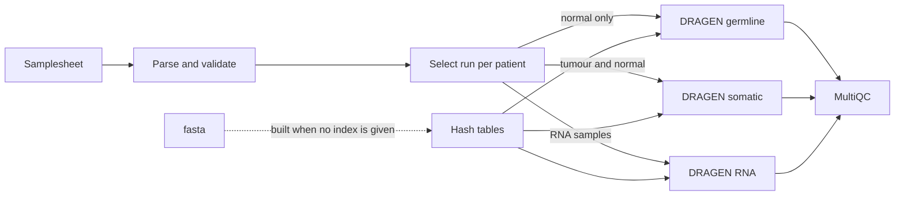
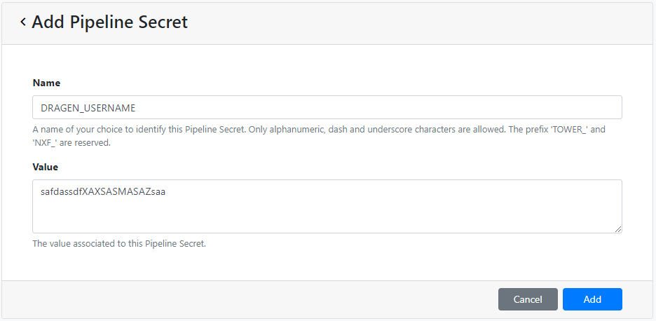
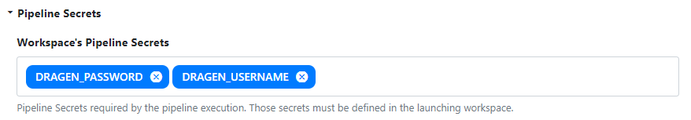

[](https://www.nextflow.io/)

> This is a proof-of-concept pipeline under active development. Syntax, layout and parameters may change without notice.

## Introduction

**seqeralabs/nf-dragen** runs the [Illumina DRAGEN](https://emea.illumina.com/products/by-type/informatics-products/dragen-bio-it-platform.html) licensed suite of tools on FASTQ samples. It produces germline calls for DNA samples, tumour/normal somatic calls, and RNA alignments, and summarises the DRAGEN metrics in a MultiQC report.

The pipeline is built with [Nextflow](https://www.nextflow.io). DRAGEN runs on Illumina's licensed AMI on AWS F2 instances, so a real run needs a Seqera Platform compute environment that provides them (see [Requirements](#requirements)).

## Pipeline steps

1. **Samplesheet parsing.** Reads the samplesheet, which uses the same columns as nf-core/sarek, and checks it before any task runs.
2. **Run selection.** Groups DNA samples by patient: a normal without a tumour gets a germline run, and each tumour gets a somatic run paired with the patient's normal. RNA samples get an RNA run.
3. **Hash tables.** Builds the DRAGEN DNA and RNA hash tables from `--fasta`, unless you supply them with `--dragen_index_dna` and `--dragen_index_rna`.
4. **DRAGEN.** Runs germline and somatic DNA calling (somatic runs also call structural and copy number variants) and RNA alignment.
5. **MultiQC.** Summarises the DRAGEN metrics and the software versions in one report. Skip it with `--skip_multiqc`.



## Quickstart

Run the test profile in stub mode from the repository root. Stub mode needs no DRAGEN licence, but the DRAGEN secrets must exist, so set dummy values first:

```bash
nextflow secrets set DRAGEN_USERNAME dummy
nextflow secrets set DRAGEN_PASSWORD dummy
nextflow run . -profile test -stub --outdir results
```

A real run needs the DRAGEN AMI and your licence credentials:

```bash
nextflow run . --input samplesheet.csv --fasta genome.fa --outdir results
```

Read [docs/usage.md](docs/usage.md) for the samplesheet format and run options.

## Requirements

- Nextflow 26.10.6 or later.
- DRAGEN licence credentials from Illumina, stored as the Nextflow secrets `DRAGEN_USERNAME` and `DRAGEN_PASSWORD`.
- A DRAGEN-capable compute environment: a private DRAGEN AMI on AWS F2 instances, in a region where F2 instances are available. The DRAGEN processes carry the `dragen` label, which sends them to those instances.
- Docker on the machine that runs MultiQC. The DRAGEN processes run on the host and need no container.

### Seqera Platform setup

You can use Seqera Batch Forge to create an AWS Batch compute environment with F2 instances. In the Seqera UI, go to `Compute Environments` -> `Add Compute Environment`, fill in your AWS Batch settings and paste your private DRAGEN AMI id:


Add the secrets `DRAGEN_USERNAME` and `DRAGEN_PASSWORD` under `Secrets` -> `Add Pipeline Secret`:




Then go to `Launchpad` -> `Add Pipeline`, and make sure the pipeline uses that compute environment and those secrets:



## Documentation

- [Usage](docs/usage.md): samplesheet format, run modes, configuration and running the pipeline.
- [Output](docs/output.md): the files the pipeline writes to `--outdir`.
- [Parameters](docs/parameters.md): every pipeline parameter.

## Credits

nf-dragen was originally written by [Harshil Patel](https://github.com/drpatelh), [Graham Wright](https://github.com/gwright99) and [Paolo Di Tommaso](https://github.com/pditommaso), [Seqera Labs](https://seqera.io/).
